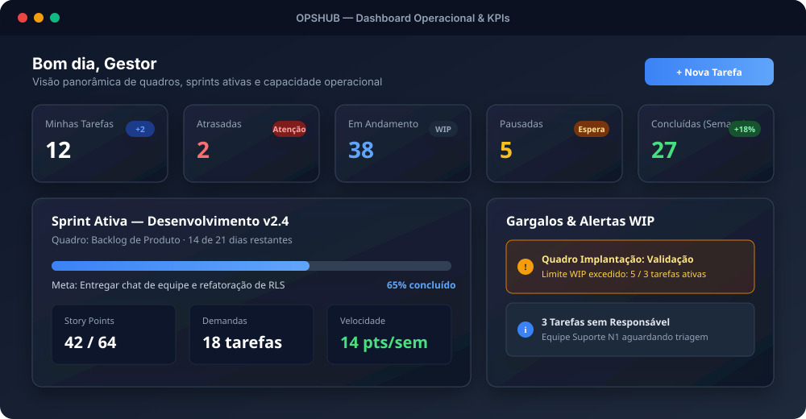
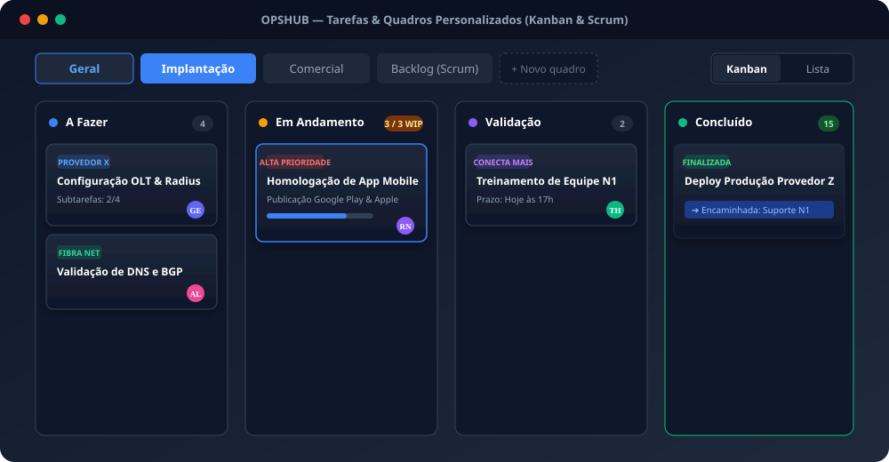
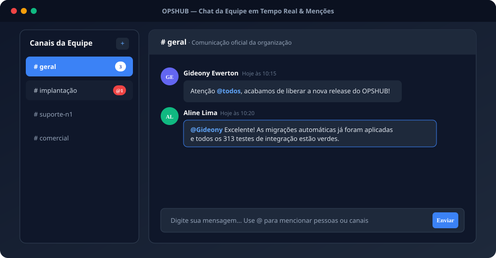
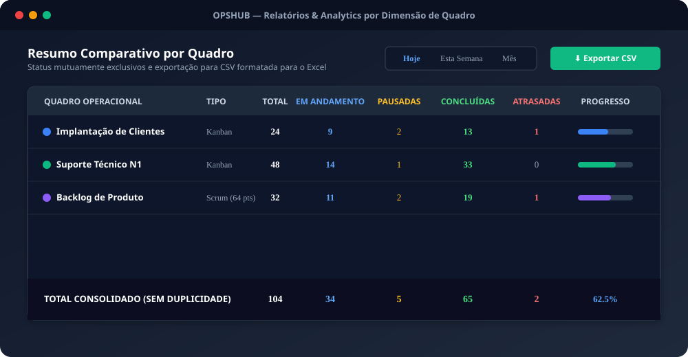
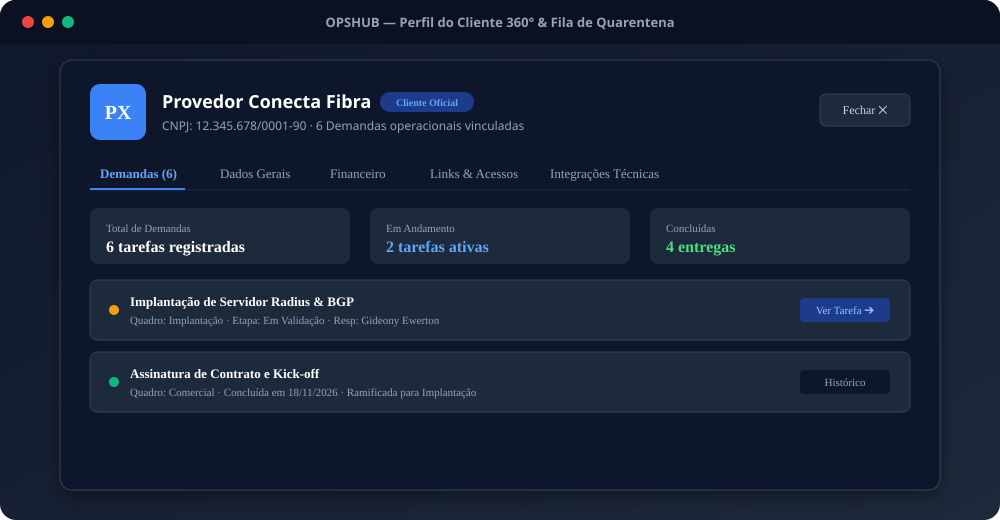

# OPSHUB

<div align="center">


**Plataforma integrada de gestão operacional de tarefas (Kanban & Scrum), comunicação em tempo real por equipes e governança de dados de clientes.**

[Recursos](#-principais-funcionalidades) • [Telas do Sistema](#-telas-do-sistema) • [Instalação Local](#-como-executar-localmente) • [Banco de Dados](#-banco-de-dados--migrations) • [Testes](#-testes--qualidade)

</div>

---

## 📸 Telas do Sistema

### 1. Dashboard Operacional & Panorama de Fluxo
Painel executivo com métricas contextuais, alertas de limite de trabalho em andamento (WIP), acompanhamento de sprints ativas e capacidade da equipe.
<p align="center">
  
</p>

### 2. Gestão de Tarefas (Kanban & Scrum)
Quadros flexíveis por setor, limites WIP visuais, modelos dinâmicos, ordenação de backlog, sprints ágeis com Burndown e ramificação de tarefas com linha do tempo imutável.
<p align="center">
  
</p>

### 3. Chat da Equipe em Tempo Real
Canais colaborativos por equipe, menções `@usuario` e `@todos`, edição inline, soft-delete compatível com LGPD, contadores de mensagens não lidas e badges integrados.
<p align="center">
  
</p>

### 4. Relatórios & Analytics Multidimensional
Consolidação analítica por quadro, status mutuamente exclusivos (`active` + `done` + `blocked` + `backlog`), cálculo canônico de atrasos e exportação para CSV compatível com o Excel.
<p align="center">
  
</p>

### 5. Gestão de Clientes 360° & Fila de Quarentena
Perfil completo com demandas vinculadas, dados de contato, notas financeiras, links técnicos seguros e fila de validação de autocadastros externos.
<p align="center">
  
</p>

---

## ✨ Principais Funcionalidades

### 📋 Tarefas, Quadros & Metodologias Ágeis
- **Quadros Kanban Personalizados:** Crie quadros corporativos ou restritos por equipe, personalize etapas, cores e limites de trabalho em andamento (WIP).
- **Metodologia Scrum Integrada:** Gestão de backlog priorizado por Story Points, ciclos de sprint com regra de unicidade e gráfico Burndown diário vetorial.
- **Visão Geral Agregadora:** Monitoramento panorâmico em Modo Lateral ou Modo Consolidado (somente leitura para evitar movimentações acidentais entre fluxos).
- **Ramificação e Encaminhamento de Demandas:** Ao concluir uma tarefa, encaminhe-a para outro setor gerando uma linha do tempo cronológica com rastreabilidade de ponta a ponta.
- **Modelos e Automações:** Templates de subtarefas por etapa e modelos de quadros reutilizáveis (*Em branco, Comercial, Implantação, Suporte, Scrum padrão*).

### 💬 Comunicação em Tempo Real
- **Canais por Equipe:** Canais privados protegidos por RLS estrutural (com canal Geral corporativo protegido contra exclusão acidental).
- **Menções Inteligentes:** Autocomplete ao digitar `@`, notificações sonoras com Web Audio API e marcação em lote `@todos`.
- **Governança & LGPD:** Exclusão lógica com limpeza do corpo da mensagem e expurgo físico de anexos no Supabase Storage.

### 👥 Clientes & Integração
- **Perfil 360°:** Visualização consolidada de todas as demandas históricas e ativas do cliente.
- **Fila de Quarentena:** Validação e triagem de novos cadastros vindos de formulários públicos externos antes de entrarem na base oficial.
- **Exportação de Dados:** Exportação completa de clientes e relatórios em CSV formatado com BOM UTF-8 e separador `;` para o Excel.

### 🎨 Experiência do Usuário & Acessibilidade
- **Temas Claro e Escuro:** Paleta semântica completa com contraste validado conforme normas WCAG AA (>= 4.5:1).
- **Central de Preferências:** Configuração de visualização padrão (Kanban vs. Lista), tela de entrada, alertas e notificações sonoras.
- **Modo Demonstração Integrado:** Funcionalidade plena do sistema mesmo sem conexão com o banco de dados.

---

## 🚀 Como Executar Localmente

### Pré-requisitos
- **Node.js** 18+ instalado
- Gerenciador de pacotes **npm** (ou yarn/pnpm)

---

### Opção 1: Execução Imediata (Modo Demonstração)
O OPSHUB conta com uma camada de dados simulados em memória (`src/demo.ts`) que permite rodar e explorar 100% da interface sem precisar configurar banco de dados ou credenciais externas.

```bash
# 1. Clone o repositório
git clone https://github.com/gideony/ops-hub.git
cd ops-hub

# 2. Instale as dependências
npm install

# 3. Inicie o servidor de desenvolvimento
npm run dev
```

Abra [http://localhost:5173](http://localhost:5173) no seu navegador para utilizar a aplicação.

---

### Opção 2: Conexão com o Supabase (Ambiente Completo)

1. Crie um projeto no [Supabase](https://supabase.com).
2. Configure o arquivo de variáveis de ambiente:
   ```bash
   cp .env.example .env
   ```
   Edite o `.env` com os dados do seu projeto:
   ```env
   VITE_SUPABASE_URL=https://seu-projeto.supabase.co
   VITE_SUPABASE_ANON_KEY=sua-chave-publica-anon
   ```
3. No SQL Editor do Supabase, execute o script mestre consolidado:
   - [`supabase/todas_migrations_somax_hub.sql`](supabase/todas_migrations_somax_hub.sql)
4. *(Opcional)* Para dados de exemplo, execute em seguida:
   - [`supabase/seed_demo.sql`](supabase/seed_demo.sql)
5. Publique as Edge Functions administrativas para gestão de usuários e canais (`supabase/functions/`).
6. Inicie a aplicação com `npm run dev`.

---

## 🗄️ Banco de Dados & Migrations

O banco de dados PostgreSQL do OPSHUB é governado por políticas de segurança a nível de linha (**Row Level Security - RLS**) e funções transacionais atômicas (RPCs):

- **Script Consolidado Mestre:** [`supabase/todas_migrations_somax_hub.sql`](supabase/todas_migrations_somax_hub.sql) reúne todo o schema, tabelas, RLS e triggers em um único arquivo, ideal para inicializar novos ambientes.
- **Histórico Incremental:** A pasta [`supabase/migrations/`](supabase/migrations/) preserva o histórico sequencial de evolução da base, assegurando compatibilidade com o versionamento do Supabase CLI (`supabase db push`).

---

## 🧪 Testes & Qualidade

A integridade das regras de negócio, cálculos de métricas e contrastes de tema é garantida por uma suíte completa de testes automatizados com Vitest:

```bash
# Rodar todos os testes
npm test

# Validação estrita de tipos e compilação de produção
npm run build
```

- **313 testes automatizados** distribuídos em 29 arquivos cobrindo permissões de RLS, concordância de status, cálculos Scrum/Kanban e acessibilidade.

---

## 🛠️ Tecnologias Utilizadas

| Camada | Tecnologia |
|---|---|
| **Frontend** | React 19, TypeScript 5.9, Vite 7 |
| **Estilização** | Tailwind CSS v4, Lucide React Icons |
| **Backend & Banco** | Supabase (PostgreSQL 15+, Auth, Realtime, Storage) |
| **Serverless** | Supabase Edge Functions (Deno / TypeScript) |
| **Testes** | Vitest, Testing Library |

---

## 📄 Licença

Distribuído sob a licença **MIT**. Consulte o arquivo [LICENSE](LICENSE) para mais detalhes.
