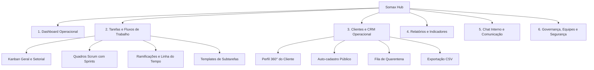
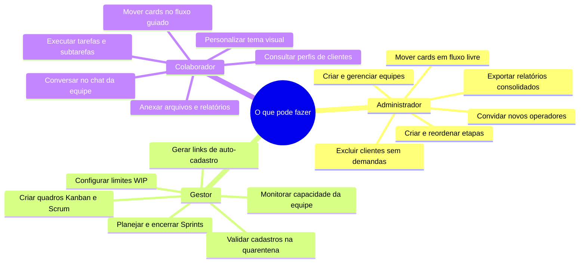

# Relatório Completo do Sistema e Funcionalidades — Somax Hub

> **Versão do Documento:** 1.0  
> **Data:** Novembro de 2026  
> **Status:** Operacional e Homologado  
> **Idioma Oficial:** Português do Brasil  
> **Ambientes Suportados:** Nuvem (Supabase + Vercel/VPS) e Demonstração Local Offline (`src/demo.ts`)

---

## 1. Visão Geral e Propósito

O **Somax Hub** é uma plataforma corporativa integrada para gestão operacional, rastreamento de tarefas ponta a ponta, governança de processos interdepartamentais, relacionamento com clientes (CRM operacional) e comunicação interna segura em tempo real.

O sistema foi arquitetado para resolver o atrito entre diferentes áreas da empresa (Comercial, Desenvolvimento, Design, Financeiro e Gestão), unificando demandas em quadros visuais intuitivos (**Kanban** e **Scrum**), automatizando a passagem de bastão através de **ramificações com linhagem histórica imutável**, e garantindo conformidade rigorosa com **segurança, LGPD e isolamento por equipe via Row Level Security (RLS)**.

### Stack Tecnológica
- **Front-end:** React 19 + TypeScript (tipagem estrita) + Vite + Tailwind CSS v4 + Lucide Icons
- **Back-end & Banco:** Supabase (PostgreSQL 15+, Auth, Realtime, Storage Privado, Edge Functions em Deno)
- **Design System:** Tokens CSS semânticos (`theme-tokens.css`), conformidade WCAG AA (contraste >= 4.5:1) e suporte nativo a temas Claro e Escuro
- **Testes & Qualidade:** Vitest (19 suítes e 213 testes automatizados aprovados)
- **Modo Demonstração:** Simulação local 100% autônoma em `src/demo.ts` (opera sem Supabase ou conexão de rede)

---

## 2. Mapa Geral de Módulos e Recursos

---

## 3. Detalhamento dos Módulos e Funcionalidades

---

### 3.1. Dashboard Operacional

O Dashboard é o ponto focal de produtividade diária de operadores, gestores e diretores.

#### Funcionalidades Principais:
1. **Saudação Contextual e Microcopy Dinâmico:** Mensagem de boas-vindas inteligente adaptada ao perfil do usuário (`Administrador`, `Gestor` ou `Colaborador`) e ao período do dia (manhã, tarde ou noite).
2. **Ações Rápidas de Topo:**
   - Botão `+ Nova Tarefa`: Abertura imediata do modal de criação de demandas.
   - Botão `Ver Tarefas`: Salto direto para a aba de tarefas no modo operacional.
   - Botão `Relatórios`: Salto direto para os indicadores executivos.
3. **Seletor Dinâmico de Escopo de Quadro:** Permite alternar instantaneamente a perspectiva do Dashboard entre:
   - *Todos os meus quadros* (visão agregada da organização);
   - *Quadro Geral* (quadro canônico);
   - Qualquer *Quadro Setorial ou Personalizado* acessível pelo usuário.
4. **Banner Inteligente de Alerta de Gargalo WIP:** Inspeciona dinamicamente os limites de trabalho em andamento (*Work In Progress*) configurados nas etapas. Caso alguma coluna atinja ou exceda o limite seguro, renderiza um alerta destacado com botão de salto direto para desobstrução da fila.
5. **Widget de Sprint Ativa (Scrum):**
   - Nome e meta da sprint atual;
   - Contagem regressiva de dias com barra de progresso visual;
   - Distribuição de pontos de história planejados vs. concluídos;
   - Atalho direto para o quadro da sprint.
6. **5 Cartões Métricos com Filtro Rápido:**
   - *Minhas tarefas:* Demandas atribuídas diretamente ao usuário logado;
   - *Atrasadas:* Tarefas em aberto com prazo vencido segundo o fuso horário oficial (`America/Fortaleza`);
   - *Próximas:* Tarefas com vencimento nos próximos 7 dias;
   - *Bloqueadas / Pausadas:* Demandas em etapa de pausa ou aguardando resposta externa;
   - *Concluídas na semana:* Volume de entregas finalizadas nos últimos 7 dias.
   - Cada cartão possui chip de filtro clicável que navega automaticamente para as tarefas correspondentes.
7. **Panorama de Fluxo Adaptativo:** Gráfico em barras horizontais que reflete a distribuição percentual de tarefas por etapa no escopo selecionado.
8. **Painel de Prioridades e Urgências:** Lista priorizada das demandas críticas com etiquetas coloridas do quadro de origem, prazo, responsável e indicador de atraso em vermelho.
9. **Painel de Capacidade da Equipe (Exclusivo para Gestores e Administradores):** Monitora a carga de trabalho de cada colaborador da equipe, sinalizando sobrecargas e destacando demandas sem responsável atribuído.

---

### 3.2. Tarefas e Fluxos de Trabalho (Kanban e Scrum)

O coração operacional do Somax Hub para execução de projetos e rotinas.

#### 1. Tipos de Quadros Suportados:
- **Quadro Geral (Canônico):** O quadro oficial e unificado com todas as 15 etapas padrão da empresa (`Backlog`, `Negociação`, `Contrato`, `Kick-off`, `Criação de Imagens`, `Desenvolvimento APP`, `Integração/Personalização`, `Homologação`, `Criação de Telas`, `Deploy`, `Aguardando Aprovação`, `Entrega`, `Faturamento`, `Concluído`, `Pausado`).
- **Visões por Setor (Espelhos):** Espelhos filtrados do Quadro Geral para equipes específicas (ex: Comercial exibindo apenas Negociação, Contrato e Kick-off). Mover um card na visão do setor reflete instantaneamente no Geral sem duplicidade de registros.
- **Quadros Personalizados (Custom Boards):** Quadros criados por gestores/administradores com colunas próprias, cores customizadas, limites WIP e regras de finalização particulares.
- **Quadros Scrum Ágeis:** Quadros com suporte completo à metodologia Scrum.

#### 2. Metodologia Scrum Completa:
- **Alternador de 4 Visões:** Em quadros Scrum, a barra superior oferece `[Kanban | Lista | Backlog | Sprint]`.
- **Backlog Priorizado:** Lista de histórias e itens de trabalho com estimativa de complexidade em Story Points (`pts`), tags, responsável e reordenação vertical livre via arrastar e soltar (*drag-and-drop*).
- **Planejamento de Sprints:** Criação de sprints com nome, meta, data de início e término. Arraste de cards do backlog diretamente para a sprint com cálculo dinâmico dos pontos planejados.
- **Regra de Unicidade Estrita:** Blindagem no PostgreSQL que impede mais de uma sprint ativa simultaneamente no mesmo quadro.
- **Quadro da Sprint Ativa:** Exibe exclusivamente as tarefas da sprint em andamento.
- **Gráfico de Burndown Diário em SVG Nativo:** Curva de queima ideal vs. queima real gerada a partir das transições registradas no histórico.
- **Encerramento de Sprint:** Modal de fechamento exibindo pontos entregues (velocidade), pendências e transição automática das tarefas inacabadas para o backlog ou para a próxima sprint.

#### 3. Modos Panorâmicos da Aba Geral:
- **Modo Lateral:** Apresenta os quadros e setores em blocos horizontais lado a lado com rolagem horizontal, alça de reordenação `::`, barra de navegação rápida "Ir para:" com chips coloridos e filtros de situação (*Em andamento*, *Concluídas*, *Todas*).
- **Modo Consolidado (Acordeão):** Faixas/raias verticais expansíveis com carregamento sob demanda (*lazy rendering*) dos cards ao expandir, estado persistido por usuário no navegador e padrão responsivo para dispositivos móveis (< 768px).

#### 4. Cards Modernos de Tarefas (Design System v2):
- Nome do cliente em destaque no topo com menu rápido de ações `...`;
- Título claro da demanda e tags em chips sutis;
- Linha de prioridade (`baixa`, `media`, `alta`, `urgente`) e prazo de entrega;
- Badge visual vermelho vibrante para prazos vencidos;
- Barra de progresso horizontal azul indicando o percentual de subtarefas/checklists concluídos;
- Avatar circular com as iniciais do responsável;
- Faixa colorida inferior indicando conexões de encaminhamento ou ramificação.

#### 5. Modal de Detalhes da Tarefa (Layout em 2 Colunas):
- **Painel Esquerdo (Conteúdo e Execução):**
  - Título editável e descrição detalhada;
  - Bloco de templates aplicados com barras de progresso azuis e percentuais de conclusão;
  - Lista interativa de subtarefas com marcação de concluído e adição rápida;
  - Editor multilinha de relatórios e comentários internos com atalho `Ctrl+Enter` e gravação resiliente;
  - **Aba Linha do Tempo:** Rastreabilidade cronológica de todas as passagens da tarefa.
- **Painel Direito (Metadados Fixos):**
  - Seletor de etapa sincronizado de forma inteligente com as colunas do quadro atual (evitando descasamentos e impedindo que tarefas sumam);
  - Prioridade e prazo com atalho de calendário;
  - Associação de cliente, equipe executora e responsável;
  - Gerenciamento de tags compartilhadas.

#### 6. Sistema de Ramificação e Linha do Tempo Imutável (ADR-014 / ADR-015):
- **Passagem de Bastão Controlada:** Quando uma tarefa é concluída na etapa final de um quadro, ela pode ser encaminhada para outro setor/quadro autorizado (ex: Comercial conclui a venda e encaminha para a Implantação).
- **Travamento Automático:** Ao ser encaminhada, a tarefa de origem fica **travada e imutável** no banco e na interface (protegida por gatilho no PostgreSQL), garantindo que seu histórico nunca seja violado ou revertido indevidamente.
- **Unicidade de Ramificação:** Cada tarefa pode gerar apenas uma ramificação direta (restrição única no banco), evitando duplicidade de fluxos.
- **Prevenção Estrita de Ciclos:** O seletor de destino bloqueia qualquer quadro que já pertença à árvore genealógica daquela tarefa (`excludedBoardIds`).
- **Navegação Bidirecional:** A tarefa original exibe o link `"Encaminhada para: [Quadro]"` e a nova exibe `"Veio de: [Quadro]"`.
- **Métrica de Jornadas Únicas:** Contabilização de métricas por `root_task_id`, impedindo que passagens de bastão entre setores inflem artificialmente os relatórios executivos.
- **Sintetizador Determinístico da Linha do Tempo (`buildDeterministicLineage`):** Reconstrói todos os passos históricos mesmo se offline ou em falhas temporárias de rede.

#### 7. Modal de Criação de Tarefas (`NewTaskForm`):
- Grid responsivo de 2 colunas;
- Busca com filtro em tempo real sobre os grupos de templates de subtarefas;
- Grade de checkboxes para seleção em lote de procedimentos operacionais;
- Botão ergonômico `"Criar e adicionar outra"` para inserção ágil em lote.

#### 8. Gerenciador de Etapas (`StageManager`):
- Localizado na aba "Fluxos" para acesso por gestores e administradores;
- Permite criar etapas, definir cores, ajustar limites WIP, definir a etapa final e reordenar por drag-and-drop ou setas do teclado;
- Função transacional segura no banco (`reorder_stages`) e proteção contra exclusão de etapas com tarefas vinculadas.

---

### 3.3. Relacionamento e CRM Operacional de Clientes

O Somax Hub centraliza a governança de dados cadastrais, financeiros e de integração dos clientes atendidos pelas equipes.

#### 1. Visualizações Principais:
- **Modo Cartões:** Cards organizados com avatar com iniciais, nome fantasia, razão social, dados de contato principal e seta de navegação;
- **Modo Tabela:** Grid tabular completo com ordenação, busca instantânea e paginação.

#### 2. Modal de Perfil Detalhado do Cliente (Redesign ADR-017):
- **Cabeçalho:** Avatar quadrado (56x56px, raio 14px), título em 22px bold, razão social em 14px, etiquetas `"Cliente oficial"` e `"[n] demanda(s)"`.
- **Ações Rápidas do Cabeçalho:**
  - Botão `"Editar cadastro"` (ação primária);
  - Botão `"Exportar"` (download imediato do CSV com os dados daquele cliente);
  - Menu `...` (`aria-label="Mais ações"`) contendo a opção `"Excluir cliente"`;
  - Botão fechar `✕`.
- **Bloqueio Rigoroso de Exclusão:** Se o cliente possuir demandas ou tarefas vinculadas, a exclusão é **bloqueada imediatamente** com aviso explicativo orientando a reatribuição ou remoção prévia das demandas. Apenas clientes com 0 tarefas vinculadas podem ser excluídos (com confirmação).
- **Rodapé Limpo:** Exclusivamente o botão `"Fechar"`, sem repetições de ID ou botões redundantes.
- **5 Abas Tipográficas WAI-ARIA em Linha Única (com navegação por teclado e contadores):**
  1. **Visão Geral:**
     - 3 cartões superiores de KPIs: *Total de demandas*, *Em andamento* e *Concluídas*.
     - Cartão *Identificação Cadastral*: Nome fantasia, Razão social e ID interno exibido **uma única vez** em fonte monoespaçada com botão `"Copiar"`.
     - Cartão *Contato Principal*: Nome do responsável, E-mail com link e botão `"Copiar"`, Telefone com link, botão `"Abrir WhatsApp"` (link direto para `wa.me`) e botão `"Copiar"`.
  2. **Financeiro:**
     - Linha de vencimento neutra (sem alertas amarelos ou alarmismos), exibindo o valor ou `"Não informado"` e botão `"Definir vencimento"` ou `"Alterar vencimento"`.
     - Cartão *Contato Financeiro*: Responsável financeiro, E-mail financeiro e WhatsApp financeiro. Campos vazios exibem `"—"` e botão sutil `"Adicionar"`. Campos preenchidos exibem botões de cópia e WhatsApp.
     - Cartão *Instruções de Faturamento*: Texto formatado com quebra de linha para notas de cobrança, dados bancários e preferências de emissão de NF.
  3. **Links e Acessos:**
     - Lista em cartões de links e portais do cliente (ex: Painel do provedor, Drive, sistemas legados).
     - Cada linha possui Nome, URL secundária, botão `"Acessar"` (abre em nova aba com `rel="noopener noreferrer"`) e botão `"Copiar"`.
     - Estado vazio amigável com botão `"Adicionar link"`.
  4. **Integrações Técnicas:**
     - Tabela com cabeçalhos rigorosamente alinhados à esquerda (*Chave*, *Valor*, *Ação*), valores em fonte monoespaçada com botão `"Copiar"`.
     - Faixa de segurança visível: *"Não registre senhas, tokens ou chaves secretas neste cadastro."*
     - Cartão inferior de *Referências de Integração* para documentação técnica de webhooks e parâmetros.
     - Estado vazio com botão `"Adicionar integração"`.
  5. **Demandas Vinculadas:**
     - Cabeçalho com pílulas informativas de demandas ativas e concluídas.
     - Linhas detalhadas de cada demanda com etiqueta de equipe/quadro, título, etapa atual, prioridade, responsável com avatar e prazo de entrega.
     - Badges identificadores para tarefas que são ramificações (`GitBranch`) ou que foram encaminhadas (`ArrowRight`).

#### 3. Auto-Cadastro Público de Clientes e Fila de Quarentena:
- **Geração de Links de Cadastro:**
  - Criação de links públicos com tokens criptográficos únicos;
  - Equipe responsável vinculada ou escopo geral;
  - Configuração de validade: 24 horas, 3 dias, 7 dias, 15 dias ou 30 dias;
  - Limite de uso: uso único (desativa após 1º envio) ou múltiplos envios (até 10);
  - Opção de solicitar dados de faturamento/financeiro no formulário;
  - Campo de observações internas.
- **Gerenciamento de Links Ativos:**
  - Painel com lista de links gerados, status (ativo/expirado), contador de submissões e botão de cópia do link;
  - Desativação manual de links a qualquer momento;
  - **Exclusão Definitiva de Links:** Exclusão com confirmação e limpeza em cascata no banco.
- **Página Pública de Auto-Cadastro (`/cadastrar/:token`):**
  - Acessível por clientes externos sem login no sistema;
  - Formulário completo para inserção de dados gerais, contatos, dados fiscais (CNPJ/CPF), financeiro e links úteis;
  - Termo de consentimento e LGPD obrigatório com carimbo de data/hora;
  - Honeypot invisível contra submissões automatizadas de bots e spammers;
  - Proteção estrita contra injeção de scripts (XSS).
- **Fila de Cadastros Pendentes em Quarentena (Novo Layout):**
  - Isolamento total: dados enviados por terceiros ficam em quarentena de segurança e **nunca entram diretamente na base oficial** sem aprovação humana expressa.
  - Cabeçalho com contagem total e frase explicativa;
  - Faixa compacta de segurança lembrando a conferência humana obrigatória;
  - Filtros em abas: `Todos (n)`, `Com dados financeiros (n)` e `Com CNPJ/CPF (n)`;
  - Cartões individuais com avatar, data e hora de submissão e etiquetas de dados presentes;
  - **Expansão Inline no Botão "Revisar":** Revela instantaneamente todos os dados preenchidos com botões diretos de `"Rejeitar"` (com justificativa opcional) e `"Aprovar e criar cliente"`;
  - Estado vazio limpo, sem contadores redundantes `"0"`.

#### 4. Exportação Completa de Clientes em CSV:
- Exportação em lote de todos os clientes filtrados ou exportação de um cliente avulso;
- Formatação profissional: BOM UTF-8 (para acentuação perfeita no Microsoft Excel), separador ponto e vírgula (`;`), e colunas completas:
  - *Identificação:* ID, Nome Fantasia, Razão Social, CNPJ/CPF;
  - *Contato Principal:* Nome, E-mail, Telefone;
  - *Financeiro:* Responsável Financeiro, E-mail Financeiro, WhatsApp Financeiro, Vencimento, Instruções de Cobrança;
  - *Técnico:* Links e Portais Úteis, Referências de Integração, Parâmetros e Chaves;
  - *Metadados:* Data de Criação e Atualização.
- Sanitização contra injeção de fórmulas CSV (prefixa caracteres `=`, `+`, `-`, `@` com apóstrofo).

---

### 3.4. Relatórios e Inteligência Operacional

Módulo de análise de desempenho, capacidade de entrega e métricas corporativas.

#### Funcionalidades Principais:
1. **Quadro como Dimensão de Análise:** Permite segmentar relatórios por *Todos os meus quadros*, *Quadro Geral*, *Visões por Setor* ou *Quadros Personalizados*.
2. **Quadro-Resumo de Indicadores Comparativos:** Tabela consolidada com uma linha por quadro contendo:
   - Nome do quadro e tipo (Geral, Setor, Personalizado, Scrum);
   - Total de tarefas;
   - Tarefas em andamento, pausadas, backlog e concluídas;
   - Volume de tarefas atrasadas;
   - Percentual de progresso com mini-barra visual de progresso;
   - Total de Story Points entregues (em quadros Scrum).
   - As visões de setor são apresentadas como linhas informativas ("visão do Geral") e ficam rigorosamente excluídas da linha de total consolidado, impedindo contagem dupla.
3. **Status Mutuamente Exclusivos (ADR-008):** Cada tarefa possui rigorosamente um status único (`active` + `done` + `blocked` + `backlog` = Total).
4. **Alerta de Atraso Conforme Fuso Oficial:** Tarefas são sinalizadas como atrasadas apenas se a data limite for estritamente anterior à data atual no fuso `America/Fortaleza`.
5. **Filtro de "Ocultar Ramificações":** Permite visualizar exclusivamente as tarefas originais da jornada do cliente.
6. **Métrica de Jornadas Únicas:** Consolida passagens de bastão entre setores por `root_task_id`.
7. **Tabela Detalhada de Demandas com Filtros Múltiplos:** Filtros combinados por busca textual, equipe, etapa, responsável, cliente, prioridade e intervalo de datas.
8. **Exportação de Relatórios para CSV:** Download de planilhas formatadas para auditoria externa.
9. **Segurança e RLS via Banco:** Agregações protegidas via procedure `get_board_report_metrics` com `SECURITY INVOKER`, garantindo que nenhum número vaze de quadros aos quais o usuário não tenha permissão.

---

### 3.5. Comunicação Interna e Chat em Tempo Real

Comunicação ágil contextualizada por equipe e demandas operacionais.

#### Funcionalidades Principais:
1. **Canais Privados por Equipe:** Cada equipe possui seu canal exclusivo com mensagens sincronizadas via Supabase Realtime.
2. **Upload Seguro de Arquivos:** Envio de imagens, PDFs e documentos armazenados no bucket protegido `chat-private`, com checagem estrita de membro ativo da equipe.
3. **Resiliência e Reconexão:**
   - Mensagens só são marcadas como enviadas após confirmação (`INSERT`) no banco;
   - Deduplicação por ID para evitar mensagens repetidas;
   - Em caso de falha de conexão, o texto permanece seguro no campo do editor com sinalização ao operador.
4. **Membros Ativos:** Apenas membros ativos da equipe conseguem ler o histórico e publicar mensagens.

---

### 3.6. Governança, Equipes, Usuários e Segurança

Mecanismos de controle corporativo, integridade de dados e proteção da informação.

#### 1. Matriz de Perfis e Permissões:
| Perfil | Escopo de Acesso | Movimentação no Kanban | Gestão de Equipes / Usuários |
| :--- | :--- | :--- | :--- |
| **Administrador** | Acesso global a todos os quadros, clientes e configurações | **Fluxo Livre:** pode mover tarefas para qualquer etapa sem restrição | Criação de equipes, convite de novos usuários, exclusão de clientes e gerenciamento total |
| **Gestor** | Acesso às suas equipes, quadros próprios e quadros corporativos | **Fluxo Guiado** no Geral e livre nos quadros que gerencia | Pode gerenciar etapas dos seus quadros e membros da sua equipe |
| **Colaborador** | Acesso restrito às equipes das quais é membro ativo | **Fluxo Guiado:** segue rigorosamente as regras de transição (`stage_transitions`) | Apenas visualização e atualização de tarefas atribuídas |

#### 2. Gestão de Equipes:
- Criação de equipes com nome e paleta de cor identificadora;
- Criação automática do canal privado "Geral" da equipe no mesmo momento;
- Associação e desativação de membros com preservação do histórico de autoria.

#### 3. Convite e Criação Segura de Usuários:
- Criação de contas corporativas via Edge Function dedicada (`invite-user`);
- A chave privilegiada `service_role` permanece isolada no servidor Deno e **nunca é exposta ao front-end**;
- Senhas temporárias entregues por canal seguro, com troca obrigatória de senha no primeiro acesso via `auth.admin.createUser`.

#### 4. Painel de Configurações Pessoais:
- Atualização do nome e WhatsApp do usuário;
- Alteração segura de senha;
- Alternância instantânea de tema: Claro, Escuro ou Automático (sistema);
- E-mail e perfil exibidos de forma protegida em modo somente leitura.

---

## 4. O Que o Sistema Tem (Arquitetura e Recursos Técnicos)

### 4.1. Banco de Dados e Migrations (PostgreSQL no Supabase)
O schema do Somax Hub é mantido por uma sequência estrita e imutável de migrations versionadas:

1. `202611100002_update_kanban_flows.sql`: Padronização das 15 etapas e regras de transição.
2. `202611100003_admin_free_flow.sql`: Implementação do fluxo livre para administradores.
3. `202611100004_update_checklist_templates.sql`: Suporte a grupos de templates de subtarefas.
4. `202611100005_update_stage_subtask_templates.sql`: Subtarefas automáticas por etapa.
5. `202611100007_custom_boards_scrum.sql`: Estrutura de quadros personalizados e Scrum.
6. `202611100008_create_custom_board_rpc_defaults.sql`: Procedimentos atômicos de criação de quadros.
7. `202611100009_custom_board_stages_and_tasks.sql`: Vínculo de tarefas a quadros específicos.
8. `202611110001_scrum_sprints_and_backlog.sql`: Tabelas de sprints, backlog e story points.
9. `202611110002_reports_board_concordance.sql`: Procedure atômica de relatórios com isolamento.
10. `202611110003_client_registration_links.sql`: Tabelas de links públicos de cadastro e submissões.
11. `202611110004_reorder_stages_fix.sql`: Procedimento atômico de reordenação de etapas.
12. `202611120001_client_financial_due_date_text.sql`: Flexibilização de vencimento financeiro textual.
13. `202611130001_tasks_client_id_on_delete_set_null.sql`: Integridade relacional de exclusão (`ON DELETE SET NULL`).
14. `202611140001_board_permissions_forwarding_rls.sql`: Blindagem de RLS para quadros e encaminhamentos.
15. `202611140002_task_branching_lineage.sql`: Ramificação de tarefas e linha do tempo imutável.
16. `202611150001_task_movements_snapshot_names.sql`: Instantâneos textuais de etapas no histórico de movimentações.

### 4.2. Segurança e LGPD
- **Row Level Security (RLS) Mandatório:** Ativado em 100% das tabelas corporativas (`tasks`, `clients`, `task_movements`, `messages`, `sprints`, etc.).
- **Isolamento entre Equipes:** Usuários de uma equipe não conseguem acessar dados de outra equipe via API ou injeção de ID (IDOR).
- **Tratamento de Dados de Clientes:** Submissões externas mantidas em quarentena segura. Consentimento LGPD explícito registrado no banco.
- **Sanitização contra XSS e CSV Injection:** Escapamento de tags HTML e proteção contra execução indevida de fórmulas no Excel.

---

## 5. O Que o Usuário Pode Fazer (Guia de Casos de Uso por Papel)

---

## 6. Garantia de Qualidade e Suíte de Testes

O projeto conta com **19 arquivos de testes unitários e de integração** executados via Vitest, totalizando **213 testes automatizados com 100% de aprovação**:

- `src/theme-contrast.test.ts`: 45 testes validando conformidade de contraste WCAG AA nos temas claro e escuro.
- `src/general-views.test.ts`: 20 testes de ordenação e visualização panorâmica.
- `src/reports.test.ts`: 18 testes de regras de status, cálculo de atraso e métricas.
- `src/board-permissions.test.ts`: 13 testes de governança e permissões por papel.
- `src/boards.test.ts`: 13 testes de criação e etapas de quadros customizados.
- `src/app-resilience.test.ts`: 11 testes de resiliência e tratamento de falhas.
- `src/scrum.test.ts`: 10 testes de sprints, backlog e regras de unicidade.
- `src/client-registration.test.ts`: 9 testes de links públicos de cadastro e quarentena.
- `src/client-profile-redesign.test.tsx`: 8 testes do novo layout de clientes e cadastros pendentes.
- `src/dashboard.test.tsx`: 8 testes do dashboard operacional aprimorado.
- `src/reports-table.test.tsx`: 8 testes da tabela de relatórios.
- `src/board-resilience.test.ts`: 8 testes de resiliência e fallback de quadros.
- `src/task-branching.test.ts`: 8 testes do sistema de ramificação e linhagem de tarefas.
- `src/client-profile-and-links.test.ts`: 7 testes de integridade e bloqueio de exclusão.
- `src/client-export.test.ts`: 6 testes de formatação e sanitização do CSV de clientes.
- `src/drafts.test.ts`: 6 testes de persistência local de rascunhos.
- `src/lib.test.ts`: 5 testes de utilitários centrais e regras de negócio.
- `src/redesign-and-bugs.test.tsx`: 5 testes de regressão visual e correções.
- `src/reports-analytics-v3.test.tsx`: 5 testes de agregação de métricas analíticas.

---

## 7. Referências e Arquivos-Chave do Projeto

Para navegação rápida no código-fonte:
- **Painel Central:** [`src/App.tsx`](file:///C:/Users/Usuario/Desktop/DEV/MEU%20HUB/somax-hub/src/App.tsx)
- **Dashboard:** [`src/Dashboard.tsx`](file:///C:/Users/Usuario/Desktop/DEV/MEU%20HUB/somax-hub/src/Dashboard.tsx)
- **Perfil do Cliente:** [`src/ClientProfileModal.tsx`](file:///C:/Users/Usuario/Desktop/DEV/MEU%20HUB/somax-hub/src/ClientProfileModal.tsx)
- **Links e Quarentena:** [`src/ClientRegistrationModals.tsx`](file:///C:/Users/Usuario/Desktop/DEV/MEU%20HUB/somax-hub/src/ClientRegistrationModals.tsx)
- **Detalhes da Tarefa:** [`src/TaskDetail.tsx`](file:///C:/Users/Usuario/Desktop/DEV/MEU%20HUB/somax-hub/src/TaskDetail.tsx)
- **Visões Panorâmicas:** [`src/GeneralViews.tsx`](file:///C:/Users/Usuario/Desktop/DEV/MEU%20HUB/somax-hub/src/GeneralViews.tsx)
- **Componentes Scrum:** [`src/ScrumComponents.tsx`](file:///C:/Users/Usuario/Desktop/DEV/MEU%20HUB/somax-hub/src/ScrumComponents.tsx)
- **Relatórios:** [`src/ReportsPage.tsx`](file:///C:/Users/Usuario/Desktop/DEV/MEU%20HUB/somax-hub/src/ReportsPage.tsx)
- **Administração de Clientes e Usuários:** [`src/AdminPages.tsx`](file:///C:/Users/Usuario/Desktop/DEV/MEU%20HUB/somax-hub/src/AdminPages.tsx)
- **Modo Demonstração Offline:** [`src/demo.ts`](file:///C:/Users/Usuario/Desktop/DEV/MEU%20HUB/somax-hub/src/demo.ts)
- **Registro de Decisões de Arquitetura (ADRs):** [`docs/decisoes.md`](file:///C:/Users/Usuario/Desktop/DEV/MEU%20HUB/somax-hub/docs/decisoes.md)
- **Guia Rápido de Instalação:** [`README.md`](file:///C:/Users/Usuario/Desktop/DEV/MEU%20HUB/somax-hub/README.md)
